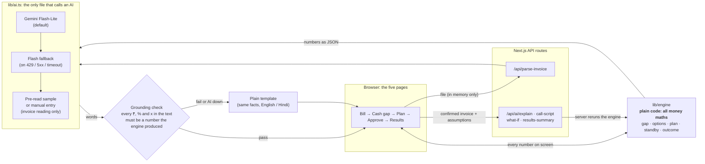

# Cash Gap Advisor

**Forward a supplier bill you can't fully pay, and get the cheapest way to pay it, which is sometimes not borrowing at all.**

|  |  |
|---|---|
| **Candidate** | Udisha Pandey | ISB
| **Live demo** | [cash-gap-advisor-qus7-git-main-razorpay-isb.vercel.app](https://cash-gap-advisor-qus7-git-main-razorpay-isb.vercel.app/) |
| **Demo video** | *Coming Tuesday* |
| **Status** | Concept prototype for the Razorpay x ISB AI PM challenge. Not affiliated with Razorpay. |

> **AI interprets and predicts. Code calculates and constrains. The merchant decides.**
>
> Everything about the merchant (sales, COD cash, bank balance, loan approval, the Touch ID tap, the post-season result, the cash forecast) is **simulated; a banner on every page says so**. The invoice reading, the cost calculator, the what-if, the explanation and the call script are real.

## Positioning

A decision layer inside RazorpayX Vendor Payments, between "invoice due" and "pay vendor". Razorpay's Cashflow Forecaster and Insights Agent warn about shortfalls and prioritise payments; Cash Gap Advisor decides how to fund the payment and re-plans as cash arrives.

## Why this matters

Large companies use treasury software (e.g. SAP Taulia) to decide when to pay suppliers and with whose money. Growing merchants have no treasury team; Razorpay already holds the data and money tools to give them that decision.

## The problem

A small D2C founder (₹10–50L a month on Razorpay, no finance team) gets a ₹5L festive-stock invoice on 2/10 net 30 terms: 2% off if paid within 10 days, otherwise the full amount in 30. Paying early saves ₹10,000, but about ₹2.3L of cash will not have arrived yet. Their instinct is to draw the whole gap on a credit line. The cheapest answer depends on **how many days each rupee is borrowed**, and the founder has no one to run the numbers.

## The journey: five screens

**Bill → Cash gap → Plan → Approve → Results**, started from an alert on Home (inside "Supplier bills", part of Vendor Payments).

1. **Bill.** Upload a PDF or photo. The AI reads it; the founder confirms or edits. Headline: "We found an early-payment opportunity", with the discount as the hero.
2. **Cash gap.** The AI forecast made visible: "You're likely ₹2,30,900 short", as a range, with a "Forecast" label and its confidence. "How we estimated this" lists festive uplift, COD share, COD timing, returns and settlement timing, each with its data source.
3. **Plan.** The cheapest safe plan: your own cash first (keeping a ₹50,000 safety buffer), then the overdraft, then the credit line. Each loan is repaid the day the sales money arrives. Tabs: Compare options, and What if sales change (slider and a typed question). A plain-language explanation and a call script for "ask for more days".
4. **Approve.** "Your money" and "Borrowed" kept apart; the illustrative Key Fact Statement before any credit; consent unticked; nothing pre-selected.
5. **Results.** Predict, re-plan, learn: a mid-season check (day 15, sales 15% below forecast) that says exactly what changes and asks to approve the updated plan; then the outcome, what the plan saved, and what the estimate learns for next time.

## Architecture



The server never trusts numbers from the browser: each AI route receives the confirmed invoice and the assumptions, **reruns the engine itself**, and gives the AI only what the engine produced.

## AI writes words, never numbers

The AI's core job is predicting cash inflows (sales, COD timing, returns) and re-planning; in this prototype the forecast is simulated. The LLM reads bills, explains plans and drafts supplier messages. Only synthetic invoices were used; the Gemini free tier must not receive real merchant data.

This is the central design rule. A money product can't have a language model inventing a rupee amount.

- The AI is given **only the engine's numbers**, as JSON with plain-word labels and ready-formatted values ("₹2,88,151", "55%"). It is told to copy them exactly.
- Its answer must pass a **grounding check** (`lib/grounding.ts`, plain code). Every ₹ amount, every percentage and every multiple ("1.3x") in the text is found and compared with the numbers it was given, with only rounding allowed ("₹2.3 lakh" for ₹2,27,621). Amounts written without a ₹ sign are caught too. So are leaked field names and, in Hindi, pasted English labels.
- If **any** number fails, the AI's text is thrown away and a **plain template** built from the same facts is shown, with a small note. The founder never sees an unchecked number.
- The typed what-if can only return **four optional numbers in fixed ranges** (sales drop 0–50%, supplier days 0–45, extra cash ₹0–10L, bank rate 5–36%). Out-of-range values are *rejected with a message*, not silently adjusted: changing the question would mislead. Code applies the numbers and reruns the engine.

It was tested the hard way. The first live explanation passed every automated check and was still useless to a founder: correct numbers, wrong content (it repeated internal field names such as "peakShortfallRupees" and printed bare digits like 288151). Checks catch false numbers; only reading the output catches unhelpful wording. The explanation is now three labelled parts: **Do this / Why it's cheapest / Watch out**.

## What the AI does vs what plain code does

| | AI | Plain code |
|---|---|---|
| Reads the invoice (PDF or photo) into fields, quoting its evidence | ✅ | |
| Founder confirms every field | | ✅ |
| Cash forecast: sales range, COD arrival and returns (simulated here, predicted by AI in production) | | ✅ |
| Re-plan as real sales arrive | | ✅ |
| Cost of every option and the interest, day by day | | ✅ |
| Which plan is cheapest, how much to draw, the standby | | ✅ |
| Sizing every plan to the peak shortfall over the whole window | | ✅ |
| Explains the plan in plain words (English / Hindi) | ✅ | |
| Checks every number in that explanation | | ✅ |
| Writes the supplier call script (talking points; nothing is sent) | ✅ | |
| Turns a typed question into up to four numbers | ✅ | |
| Applies those numbers and reruns the maths | | ✅ |
| After the season: money saved, unnecessary borrowing, what was learned | | ✅ |
| One-line summary of the result | ✅ | |

## Trust and compliance

- **The founder approves every credit action.** No automatic drawdowns. No plan, consent box or approval is ever pre-chosen.
- **Key Fact Statement first.** Credit is shown separately, with the RBI-style Key Fact Statement and an explicit consent, before anything is drawn. *(The lender, fees and contacts in it are labelled "Illustrative values": it is a prototype.)*
- **Loan to the founder's own account, then a separate supplier payment.** Prototype disburses credit to the merchant's account before paying the supplier; production would follow the lending partner's RBI-compliant disbursal structure. The bank overdraft is drawn by the founder at their own bank, outside the approval.
- **The invoice is never stored.** It is read in memory, never saved to disk, and its contents and file name are never logged.
- **No dark patterns.** No pre-selected loan, no countdown timers, every cost shown side by side. The plan compares Razorpay and non-Razorpay sources on equal terms and uses whichever is cheaper: in the demo, the founder's own bank overdraft (₹1,00,000 at 11%) is used before Razorpay's credit line because it costs less for the days needed. Every funding step is tagged with who provides it, and the overdraft is marked "Your own bank, not Razorpay" on the Options and Approve screens.
- **Backup instead of over-borrowing.** The plan is sized to *expected* sales, so the founder never borrows for a case that may not happen. The extra cash that *could* be needed at low sales is shown as **Backup**: covered by unused credit-line headroom, **₹0 cost unless drawn**, never drawn automatically, with a warning if the headroom can't cover it.
- **A supplier extension is a request, never funding.** It appears as "Ask first" with a call script, and no plan ever depends on it.
- **A money product must never under-borrow.** Every plan is sized to the *peak* cumulative shortfall across every day up to the due date, not one day's snapshot. A test checks that no plan, slider value or scenario ever leaves the balance negative on any day.

## Real vs simulated

| | Real | Simulated (labelled in the UI) |
|---|---|---|
| Invoice reading from a PDF / photo | ✅ | |
| Cost calculator, gap range, plan sizing, what-if slider | ✅ (on simulated inputs) | |
| Explanation, call script, typed what-if | ✅ | |
| Merchant's sales history, bank balance, COD cash and returns | | ✅ |
| Credit-line and overdraft limits, loan approval, the Key Fact Statement lender | | ✅ |
| Touch ID tap and the supplier payout | | ✅ |
| Post-season results (three made-up seasons) | | ✅ |
| Razorpay test-mode API call | not built | |

## The key finding

> **Compare rupees for the days you need the money, and repay each loan the day the cash arrives.**

I fact-checked the engine's assumptions against public sources. Razorpay's credit line has zero pre-closure charges, so an early version's hero ("instant settlement beats a loan") was wrong: a loan repaid in days costs only those days of interest. The engine now repays each loan as cash allows and picks the cheapest funding order. In the demo (illustrative rates):

| Source | Amount | Days | Cost |
|---|---|---|---|
| Your cash | ₹2,59,100 | | ₹0 |
| Your bank overdraft | ₹1,00,000 | 8 | ₹208 |
| Razorpay credit line | ₹1,30,900 | 5 | ₹209 |
| **Total** | | | **₹417** |

Paying ₹4,90,000 on 21 Oct instead of ₹5,00,000 on 10 Nov leaves the founder **₹9,583 better off** (₹10,000 discount less ₹417). Instant settlement is not used because the overdraft is cheaper.

## Try it

Open the live demo and choose **Use sample bill** on the Bill screen, or download a synthetic bill and upload it:

- [Bill 1: Shree Ganesh Footwear](public/samples/invoice-clean.pdf) (₹5,00,000, 2% off within 10 days, due in 30 days). The demo plan funds it with cash, an overdraft and Razorpay credit.
- [Bill 2: Kaveri Soles & Uppers](public/samples/sample-invoice-2-kaveri-soles.pdf) (₹2,70,000, 1.5% off within 15 days, net 45 days). Paying early needs no borrowing, so the plan uses cash only.

Both are made up and carry a "synthetic" notice. If the AI is busy, each loads its saved reading instead of an error.

Note: The 'What if sales are lower?' check is deliberately cautious. It only recommends paying early if your unused credit limits would cover a low-sales case all the way to the due date. For bills with long due dates (e.g. sample bill 2), it may say 'pay on the due date' even when paying early costs very little. A future version would weigh the size of the risk, not just yes or no.

## How to run

```bash
npm install
touch .env.local             # then add the variables below
npm run dev                  # http://localhost:3000
```

Variables (all in `.env.local`, which is git-ignored; never commit a key):

| Variable | What it does |
|---|---|
| `GEMINI_API_KEY` | Key for the default provider (Gemini). |
| `AI_PROVIDER` | `gemini` (default) or `claude`. |
| `GEMINI_MODEL` | Default `gemini-3.5-flash-lite`. |
| `GEMINI_FALLBACK_MODEL` | Tried once on 429 / 5xx / timeout. Default: the other Gemini model. `off` disables it. |
| `ANTHROPIC_API_KEY`, `CLAUDE_MODEL` | Only if `AI_PROVIDER=claude`. |
| `AI_MOCK` | `true` makes every AI feature return a built-in answer after a short pause, with **no API call and no key needed**. Mock answers go through the same grounding check and show a "Mock AI" badge. Use it for development and demos without a quota. **It must never be on in production.** |

```bash
npm test                     # 796 tests across 30 files; AI is always mocked, no network
npm run build                # production build
npm run smoke:ai             # LIVE: calls the real model once per feature. Run sparingly (free-tier quota).
npm run smoke:ai -- 2 explain-hi   # cap the calls, and run just one step
npm run try:extract          # LIVE: read a sample invoice with the real AI
npm run eval:extract -- --model gemini-3.5-flash-lite   # LIVE: 5 calls; scores a model on the 5 test invoices and writes docs/EVAL.md
```

Five sample invoices (all synthetic, with different layouts, languages and fine print) are in `public/samples/`; their ground truth is in `eval/`. If the AI is unavailable the invoice screen offers a labelled **pre-read sample** or **manual entry**, so the demo never dead-ends.

## Documents

- [`docs/SPEC.md`](docs/SPEC.md): the locked product spec.
- [`docs/ASSUMPTIONS.md`](docs/ASSUMPTIONS.md): every number and rule the prototype assumes (100+ rows), updated whenever one changes.
- [`docs/BUILD_LOG.md`](docs/BUILD_LOG.md): what the AI did, what went wrong, and what I decided, day by day.
- AI build log: [`docs/AI_BUILD_LOG.md`](docs/AI_BUILD_LOG.md)
- [`docs/EVAL.md`](docs/EVAL.md): how well each model reads invoices: five synthetic test invoices with hand-written ground truth, scored field by field, with a comparison table.
- [`CLAUDE.md`](CLAUDE.md): the project rules Claude Code worked under.

## Limitations and roadmap

**Limitations (honest ones)**

- One simulated merchant and one sales driver (a festive uplift). No real Razorpay data, lender or settlement feed.
- The sales forecast is simple statistics on synthetic data; the plan is sized to *expected* sales, so at low sales it relies on standby. For some inputs the standby is larger than the unused headroom, and the app warns rather than hiding it.
- The post-season screen shows three made-up seasons; "what I learned" moves each estimate halfway toward one season, which is a thin basis.
- The Hindi was drafted by an AI and has not been reviewed by a native speaker. Real Hindi AI answers are number-checked like English ones, but the wording needs a human review.
- Key Fact Statement values are placeholders; this is not a lending product.
- State lives in the browser session only. No accounts, no persistence.
- Vercel's request-body limit (4.5 MB) is below the 5 MB upload limit, so very large invoice files can fail in production.
- The free Gemini tier is small; use `AI_MOCK=true` for development.
- Invoice forwarding: today, upload. Next: forward the invoice on WhatsApp to Razorpay's RAY assistant.
- Not built from the spec: the optional Razorpay test-mode API call.

**Roadmap**

- Replace simulated data with the merchant's real Razorpay settlement and COD history; train the sales and return estimates on it.
- Invoice forwarding: today, upload. Next: forward the invoice on WhatsApp to Razorpay's RAY assistant. Later, RazorpayX bill detection, so no forwarding is needed.
- A native-speaker review of the Hindi, and more languages.
- Learn from many seasons instead of one; show forecast error over time.
- A real partner-lender integration with a genuine Key Fact Statement, and the Razorpay test-mode call.

## Designed for a founder, not a finance person

Every screen reads like a Razorpay dashboard page: a label, a number, a short caption, and the detail in tabs and tables. There is no explanatory paragraph on a default view. The copy was written by hand; the numbers come from the engine. Screenshots of Home, Cash gap, Plan and Results are in [`docs/redesign-v2/`](docs/redesign-v2/).

## Visual style

Visual style uses design tokens from Razorpay's open-source Blade design system (MIT). Only the token values (colours, type scale, radius, shadow, fonts: Inter and TASA Orbiter) are read from `@razorpay/blade`; none of its components are used, and there is no Razorpay logo or wordmark. A test checks every value in `app/globals.css` against the package.

## Built with Claude Code

This was built end to end with [Claude Code](https://claude.com/claude-code), working under the rules in `CLAUDE.md` and against the locked spec. I made the product decisions; Claude Code wrote the code, the tests (including breaking each safeguard on purpose to confirm the tests catch it), and found some of its own bugs, such as a plan that under-borrowed by about ₹39,000 because it looked at one day. The honest story of what worked and what didn't is in [`docs/BUILD_LOG.md`](docs/BUILD_LOG.md).

Stack: Next.js 16 (App Router) · TypeScript · Tailwind · Zod · Vitest · Gemini (Claude switchable) · Blade design tokens.
